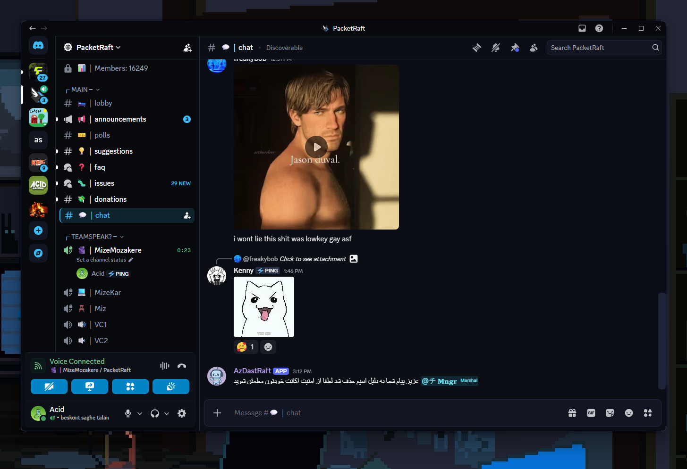
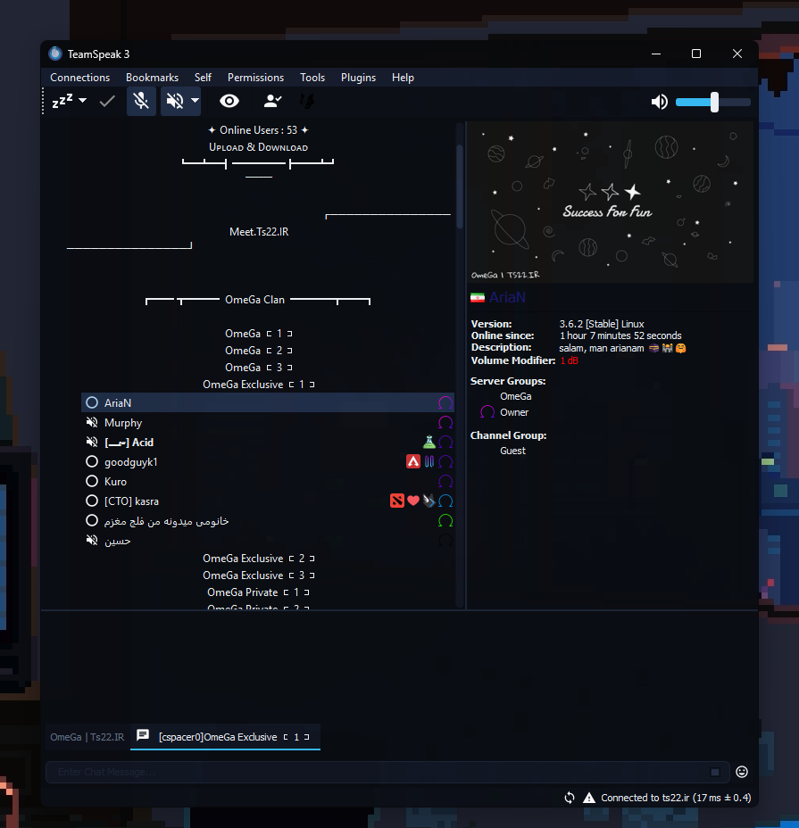

<div align="center">

# Behbahans Night

Cohesive dark theme suite built on deep obsidian navy (`#08090C`) and glowing sky-blue (`#38BDF8`) accents.

[Palette](#palette) · [Themes](#themes) · [Companions](#companions) · [License](#license)

</div>

---

## Palette

| Token | Hex | Role |
| :--- | :--- | :--- |
| Canvas | `#08090C` | App frame & deepest backdrop |
| Base | `#0B0E14` | Primary content & chat canvas |
| Surface | `#121622` | Cards, panels & inputs |
| Border | `#1E2538` | Dividers & hover surfaces |
| Accent | `#38BDF8` | Active states, links & glow |

---

## Themes

### Spicetify
Available on **Spicetify Marketplace**, or copy `spicetify/` to `%userprofile%\.spicetify\Themes\Behbahans_Night\` (`~/.config/spicetify/Themes/Behbahans_Night/`) and run:
```bash
spicetify config current_theme Behbahans_Night color_scheme Behbahans_Night && spicetify apply
```


### Vencord
Copy [`vencord/Behbahans_night.theme.css`](vencord/Behbahans_night.theme.css) to `%AppData%\Vencord\themes\` (`~/.config/Vencord/themes/`) and enable it in **Settings → Vencord → Themes**.



### Telegram Desktop
Drag [`telegram/Behbahans_night.tdesktop-theme`](telegram/Behbahans_night.tdesktop-theme) into any chat and click **Apply this theme**.


### TeamSpeak 3
Copy `teamspeak/*.qss` to `%AppData%\TS3Client\styles\` (`~/.ts3client/styles/`) and select **Behbahans_night** under **Tools → Options → Design**.



### OBS Studio
Copy [`obs/Behbahans_night.ovt`](obs/Behbahans_night.ovt) to `%AppData%\obs-studio\themes\` (`~/.config/obs-studio/themes/`), then set **Theme → Yami** and **Style → Behbahans Night** in **Settings → Appearance**.


### Windows Terminal
Merge the scheme from [`terminal/behbahans-night.json`](terminal/behbahans-night.json) into `settings.json` and set `"colorScheme": "Behbahans Night"` under `profiles.defaults`.

---

## Companions

Standalone utilities sharing the Behbahans Night aesthetic:

### [Foshorde](https://github.com/Acid-hastam/Foshorde)
Hardware-accelerated video compressor with exact target-size presets for Discord, WhatsApp, Telegram, and YouTube.


### [KojaRaft](https://github.com/Acid-hastam/KojaRaft)
Real-time network monitor tracking per-application bandwidth across VPN and direct connections.


---

## License

Released under the [MIT License](LICENSE).
