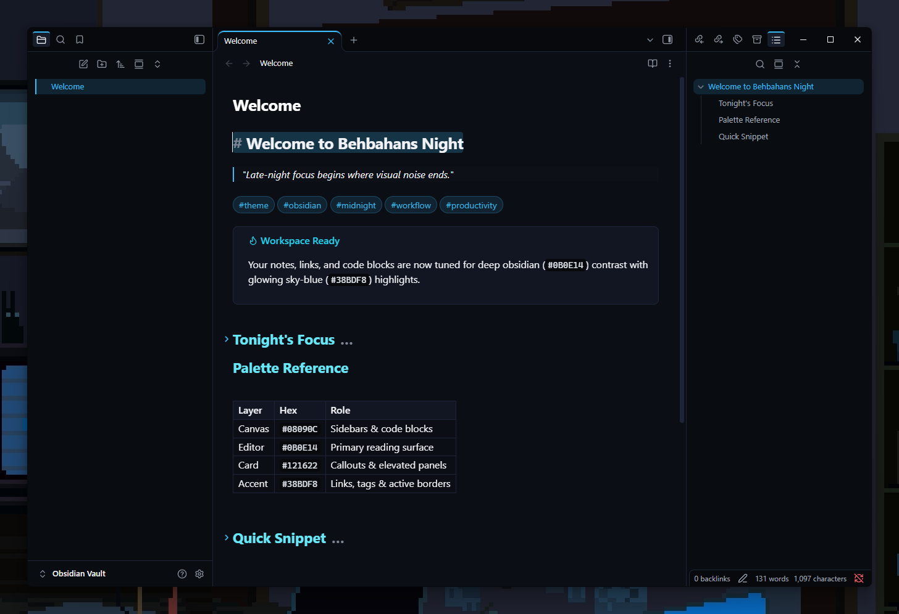
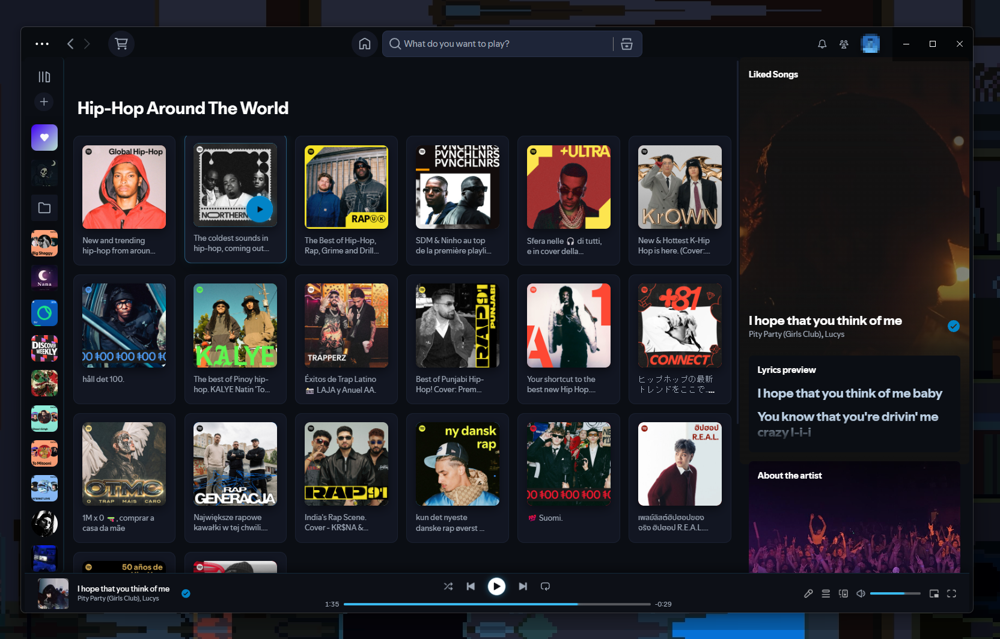
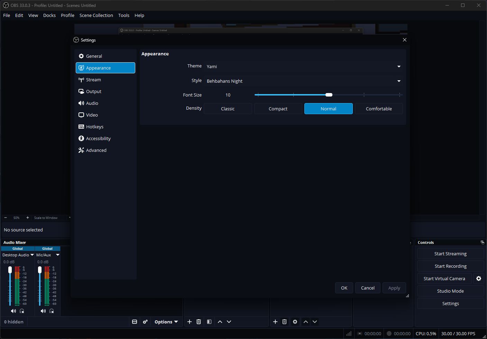

# Behbahans Night

Cohesive dark theme suite built on deep obsidian navy (`#08090C`) and glowing sky-blue (`#38BDF8`) accents.

[Palette](#palette) · [Community Stores](#community-stores) · [Themes](#themes) · [Installation](INSTALL.md) · [Companions](#companions)

---

## Palette

| Canvas | Base | Surface | Border | Accent |
| :---: | :---: | :---: | :---: | :---: |
| `#08090C` | `#0B0E14` | `#121622` | `#1E2538` | `#38BDF8` |

---

## Community Stores

| App | Status | Install |
| :--- | :--- | :--- |
| **VS Code** | Live on [VS Code Marketplace](https://marketplace.visualstudio.com/items?itemName=Acid-hastam.behbahans-night) | Search `Behbahans Night` (`Acid-hastam.behbahans-night`) |
| **Spicetify** | Live on **Spicetify Marketplace** | Search `Behbahans Night` in Marketplace → Themes |
| **Obsidian** | Live on [Obsidian Community](https://community.obsidian.md/themes/behbahans-night) | Search `Behbahans Night` in Settings → Appearance → Themes |

---

## Themes

> Full setup steps are in **[INSTALL.md](INSTALL.md)**.

<table>
  <tr>
    <td width="50%" align="center">
      <b>VS Code</b> · <code>Community Store</code> · <a href="INSTALL.md#vs-code">Install →</a>  
      
    </td>
    <td width="50%" align="center">
      <b>Obsidian</b> · <code>Community Store</code> · <a href="INSTALL.md#obsidian">Install →</a>  
      
    </td>
  </tr>
  <tr>
    <td width="50%" align="center">
      <b>Spicetify</b> · <code>Community Store</code> · <a href="INSTALL.md#spicetify">Install →</a>  
      
    </td>
    <td width="50%" align="center">
      <b>Vencord</b> · <a href="INSTALL.md#vencord">Install →</a>  
      
    </td>
  </tr>
  <tr>
    <td width="50%" align="center">
      <b>Telegram Desktop</b> · <a href="INSTALL.md#telegram-desktop">Install →</a>  
      
    </td>
    <td width="50%" align="center">
      <b>OBS Studio</b> · <a href="INSTALL.md#obs-studio">Install →</a>  
      
    </td>
  </tr>
  <tr>
    <td colspan="2" align="center">
      <b>TeamSpeak 3</b> · <a href="INSTALL.md#teamspeak-3">Install →</a>  
      
    </td>
  </tr>
</table>

---

## Companions

<table>
  <tr>
    <td width="50%" align="center">
      <b><a href="https://github.com/Acid-hastam/Foshorde">Foshorde</a></b> 
      Hardware-accelerated video compressor with target-size presets.  
      
    </td>
    <td width="50%" align="center">
      <b><a href="https://github.com/Acid-hastam/KojaRaft">KojaRaft</a></b> 
      Real-time per-app network monitor across VPN & direct traffic.  
      
    </td>
  </tr>
</table>

---

## License

Released under the [MIT License](LICENSE).
