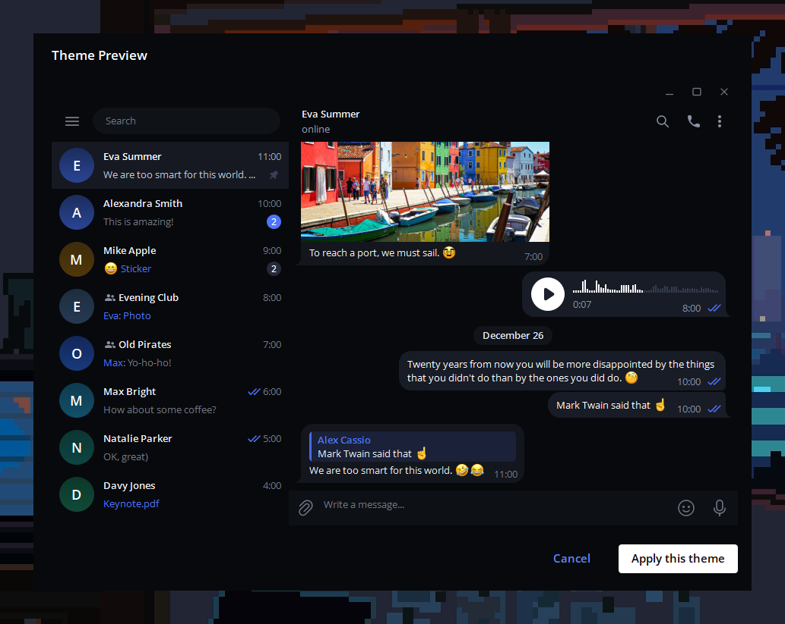

# Behbahans Night

A cohesive, late-night dark theme suite featuring deep obsidian navy backgrounds, crisp typography, and glowing cyan (`#38BDF8`) accents. Crafted for low-glare comfort across your favorite desktop applications.

---

## Color Palette

| Role | Hex | Preview |
| :--- | :--- | :--- |
| **Background (Canvas)** | `#08090C` / `#0B0E14` | Deep Midnight Obsidian |
| **Elevated Surface** | `#121622` / `#141824` | Cards, Modals & Panels |
| **Sidebar** | `#090C10` | Navigation & Channel Lists |
| **Primary Accent** | `#38BDF8` | Neon Sky-Blue Glow |
| **Accent Hover** | `#67E8F9` | Bright Cyan Highlight |
| **Primary Text** | `#FFFFFF` / `#F0F2F5` | High-Contrast Foreground |
| **Muted Text** | `#7E8696` / `#A0AAB8` | Metadata & Secondary Labels |

---

## Previews

### Spicetify (Spotify)


### Telegram Desktop


### TeamSpeak 3


---

## Installation

### 1. Spicetify (Spotify)
1. Copy the contents of the `spicetify/` folder into your Spicetify Themes directory:
   - **Windows:** `%userprofile%\.spicetify\Themes\Behbahans_Night\`
   - **Linux / macOS:** `~/.config/spicetify/Themes/Behbahans_Night/`
2. Apply the theme via terminal:
   ```bash
   spicetify config current_theme Behbahans_Night
   spicetify config color_scheme Behbahans_Night
   spicetify apply
   ```

### 2. Telegram Desktop
1. Open **Telegram Desktop**.
2. Drag and drop `telegram/Behbahans_night.tdesktop-theme` into any chat window, or double-click the file directly.
3. Click **Apply this theme** in the preview dialog.

### 3. TeamSpeak 3
1. Copy `teamspeak/Behbahans_night.qss` and `teamspeak/Behbahans_night_chat.qss` into your TeamSpeak 3 styles directory:
   - **Windows:** `%AppData%\TS3Client\styles\`
   - **Linux:** `~/.ts3client/styles/`
2. Open TeamSpeak 3 and go to **Tools -> Options -> Design**.
3. Under **Theme**, select **Behbahans_night** and click **OK**.

### 4. Windows Terminal
1. Open **Windows Terminal** and press `Ctrl + ,` to open Settings.
2. Click **Open JSON file** at the bottom-left to edit `settings.json`.
3. Copy the color scheme object from `terminal/behbahans-night.json` into your `"schemes"` array.
4. Set `"colorScheme": "Behbahans Night"` under `"profiles"` -> `"defaults"`.

### 5. Vencord (Discord)
1. Copy `vencord/Behbahans_night.theme.css` into your Vencord themes folder:
   - **Windows:** `%AppData%\Vencord\themes\`
   - **Linux / macOS:** `~/.config/Vencord/themes/`
2. Open **Discord -> Settings -> Vencord -> Themes**.
3. Click **Load missing Themes** (if needed) and toggle **Behbahans Night** on.

### 6. OBS Studio (30.2+)
1. Copy `obs/Behbahans_night.ovt` into your OBS themes directory:
   - **Windows (User):** `%AppData%\obs-studio\themes\`
   - **Windows (System):** `C:\Program Files\obs-studio\data\obs-studio\themes\`
   - **Linux:** `~/.config/obs-studio/themes/`
2. Open **OBS Studio -> Settings -> Appearance**.
3. Keep **Theme** set to **Yami** (base) and set **Style** to **Behbahans Night**, then click **Apply**.

---

## Matching Companion Projects

Two standalone Windows utilities built with the same dark obsidian aesthetic:

### [Foshorde](https://github.com/Acid-hastam/Foshorde)
A fast, hardware-accelerated video compressor with exact target-size presets for Discord, WhatsApp, Telegram, and YouTube.


### [KojaRaft](https://github.com/Acid-hastam/KojaRaft)
A lightweight real-time network and internet traffic monitor that tracks per-application bandwidth usage across VPN and direct connections.


---

## License

This repository is licensed under the [MIT License](LICENSE).
