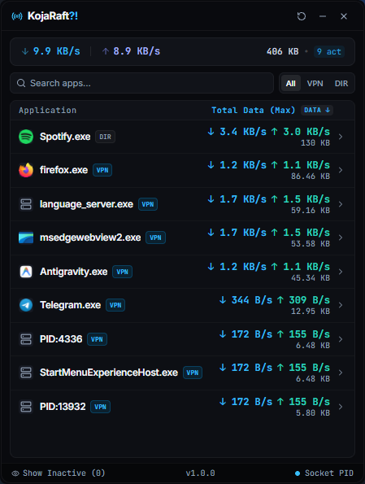

# Behbahans Night

Cohesive dark theme suite built on deep obsidian navy (`#08090C`) and glowing sky-blue (`#38BDF8`) accents.

[Palette](#palette) · [Themes](#themes) · [Installation](INSTALL.md) · [Companions](#companions) · [License](#license)

---

## Palette

| Token | Hex | Role |
| :--- | :--- | :--- |
| Canvas | `#08090C` | App frame & deepest backdrop |
| Base | `#0B0E14` | Primary content & chat canvas |
| Surface | `#121622` | Cards, panels & inputs |
| Border | `#1E2538` | Dividers & hover surfaces |
| Accent | `#38BDF8` | Active states, links & glow |

---

## Themes

> Setup steps for all supported apps are in the **[Installation Guide](INSTALL.md)**.

### Spicetify · [Install →](INSTALL.md#spicetify)

### Vencord · [Install →](INSTALL.md#vencord)

### Telegram Desktop · [Install →](INSTALL.md#telegram-desktop)

### TeamSpeak 3 · [Install →](INSTALL.md#teamspeak-3)

### OBS Studio · [Install →](INSTALL.md#obs-studio)

### Windows Terminal · [Install →](INSTALL.md#windows-terminal)
Color scheme available in [`terminal/behbahans-night.json`](terminal/behbahans-night.json).

---

## Companions

Standalone utilities sharing the Behbahans Night aesthetic:

### [Foshorde](https://github.com/Acid-hastam/Foshorde)
Hardware-accelerated video compressor with exact target-size presets for Discord, WhatsApp, Telegram, and YouTube.

### [KojaRaft](https://github.com/Acid-hastam/KojaRaft)
Real-time network monitor tracking per-application bandwidth across VPN and direct connections.

---

## License

Released under the [MIT License](LICENSE).
